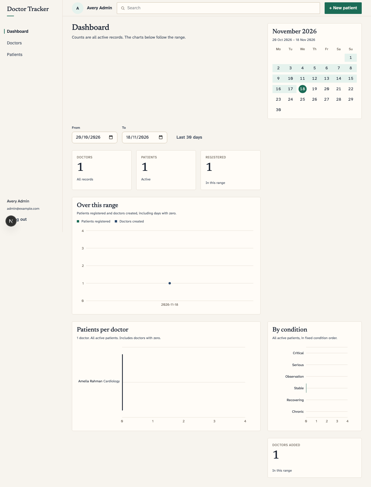
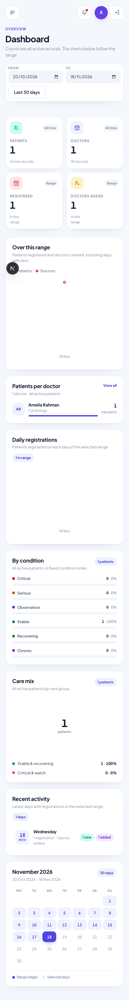
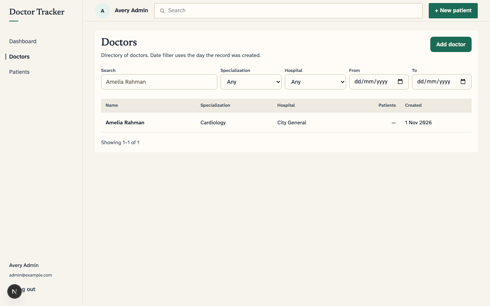
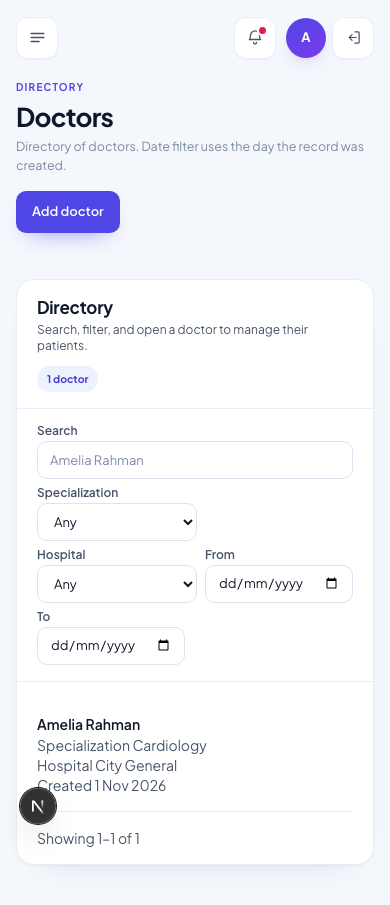
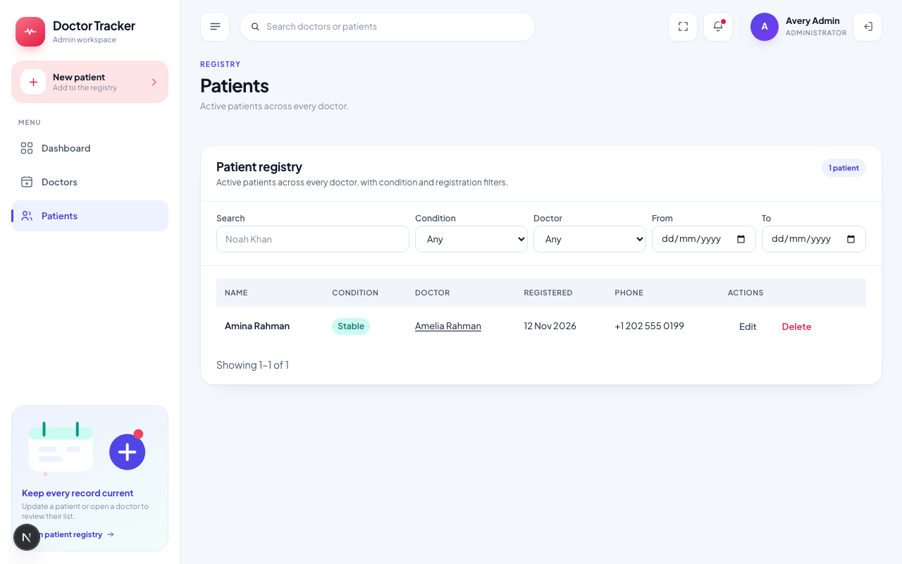
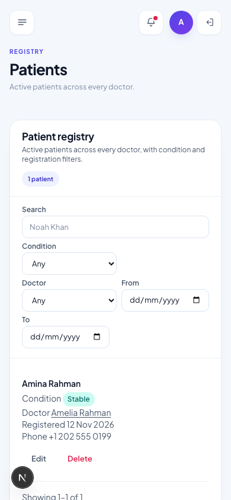

# Doctor Tracker Web

Admin portal for the doctor directory, the patient registry, and the dashboard. This app is its own repository. It reads and writes through the [Doctor Tracker API](https://doctor-tracker-api.ahr-web-pro.workers.dev/api/docs). When both checkouts sit side by side, the API project is `api-doctor-tracker`.

## Production

| App    | URL                                    |
| ------ | -------------------------------------- |
| Portal | https://task-doctor-tracker.vercel.app |

Deployed on Vercel. The Vercel project sets `NEXT_PUBLIC_API_URL` to `/api/v1` and `API_ORIGIN` to the deployed API origin, so the rewrite in `next.config.ts` keeps the HttpOnly refresh cookie first-party.

## Setup

Requires Node.js 22 (`nvm use`). Node 22 and stable Safari have no native `Temporal`, so the app installs `temporal-polyfill` from `src/lib/time/temporal.ts` before calendar code runs. Do not branch on browser support; keep calendar math in `src/lib/time/calendar.ts`.

```bash
npm install
cp .env.example .env.local
```

Set `NEXT_PUBLIC_API_URL` to `/api/v1`. The browser never calls the API host directly: `next.config.ts` rewrites `/api/v1/*` to `API_ORIGIN` in the Next server, which keeps the HttpOnly refresh cookie first-party so it survives a reload. Set `API_ORIGIN` to the API origin with no trailing slash — `http://localhost:9000` for a local API, or the deployed API URL. The browser keeps the access token in memory and sends the refresh cookie with `credentials: "include"`.

```bash
npm run dev
```

Open [http://localhost:3000](http://localhost:3000). Sign in with the admin seeded by the API.

## Scripts

| Script                 | What it does                                       |
| ---------------------- | -------------------------------------------------- |
| `npm run dev`          | Next.js dev server                                 |
| `npm run build`        | Production build                                   |
| `npm start`            | Serve the production build                         |
| `npm test`             | Vitest unit tests                                  |
| `npm run test:e2e`     | Playwright: login, delete confirm, empty dashboard |
| `npm run typecheck`    | `tsc --noEmit`                                     |
| `npm run lint`         | ESLint, zero warnings                              |
| `npm run format:check` | Prettier check                                     |

## Technical decisions

**Server data lives in TanStack Query, not Redux.** The screens are a cache of the API. Doctors, patients, and the dashboard each have a query key, a stale time, and an invalidation after a write. A client store such as Redux would copy those responses into reducers and still need in-flight requests, de-duplication, and cache invalidation. Redux fits shared client state. This portal's shared state is server state. The access token stays in a module variable. It is not in Redux, and it is not in `localStorage`.

**Dashboard figures are aggregated when they are read.** The page sends a `from`/`to` range and draws the series the API returns, including days whose count is zero. The client does not keep a running patient counter on each doctor. A stored counter would have to change on every registration and every delete, and a missed update would stay wrong in the tiles and the charts. Asking for the range at read time keeps one number on the screen for that window. The four tiles that say "All records" or "Active" are the totals in that response. The tiles that say "In this range" are sums of the daily series, still computed from the payload just loaded, not from a counter the browser remembers.

## Screenshots

Desktop is 1280px wide. Mobile is 390px wide. `npm run test:e2e` refreshes these files.

| Screen    | Desktop                                                       | Mobile                                                      |
| --------- | ------------------------------------------------------------- | ----------------------------------------------------------- |
| Dashboard |  |  |
| Doctors   |      |      |
| Patients  |    |    |

- [x] Dashboard, desktop and mobile
- [x] Doctors, desktop and mobile
- [x] Patients, desktop and mobile
