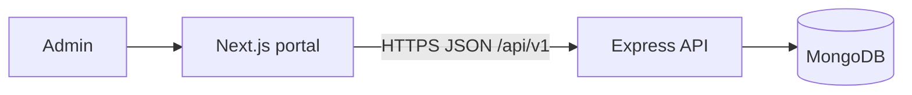
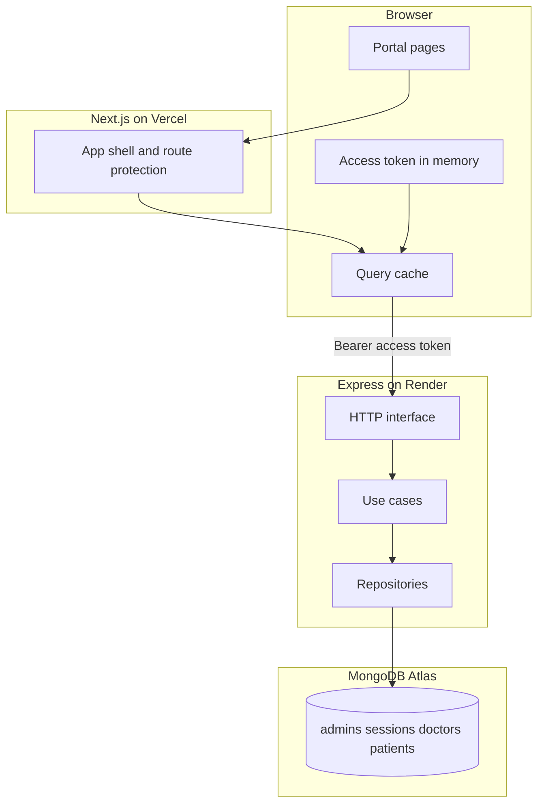
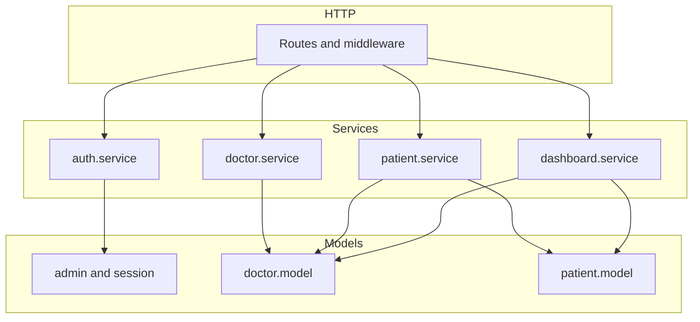
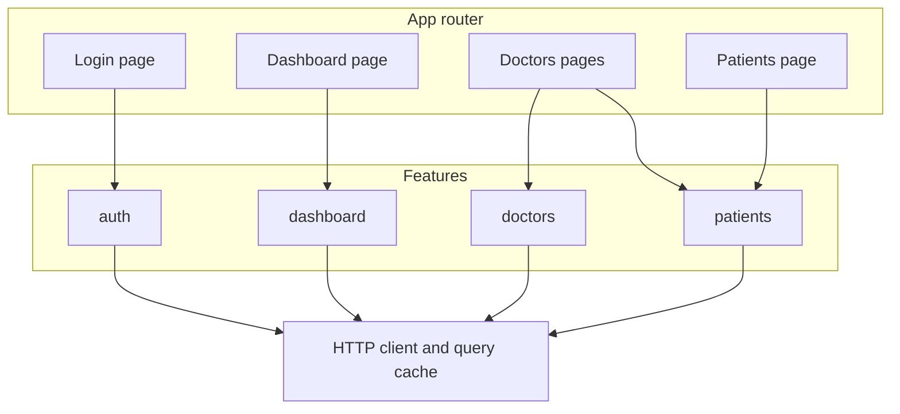
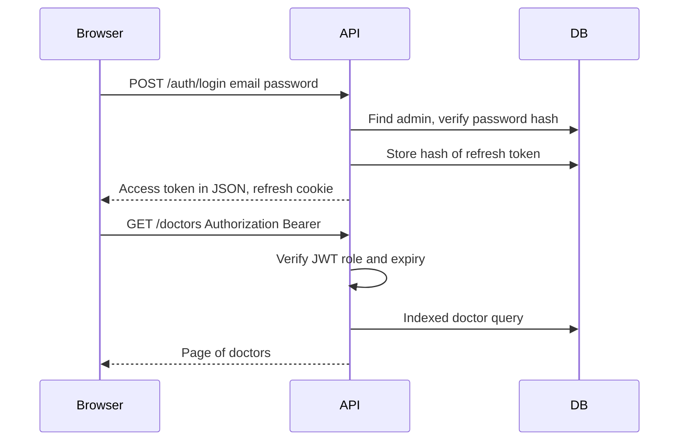
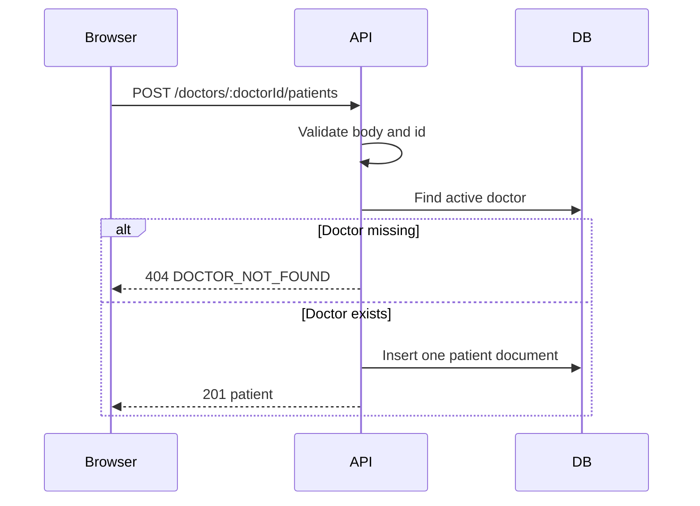
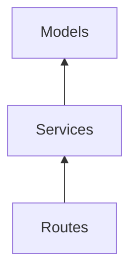
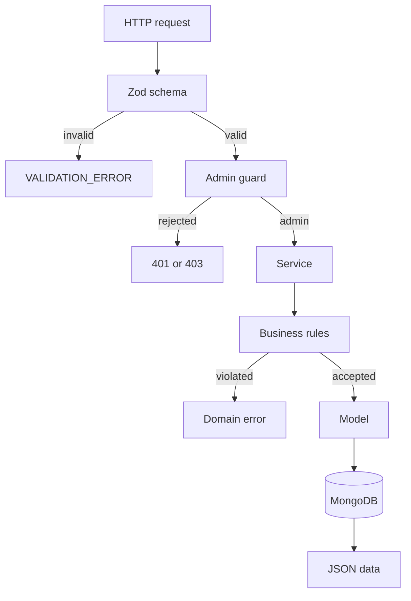
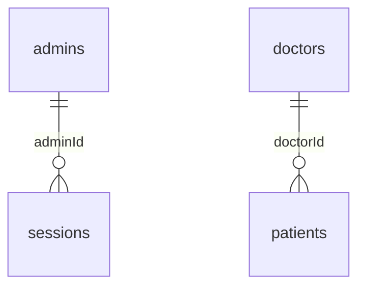
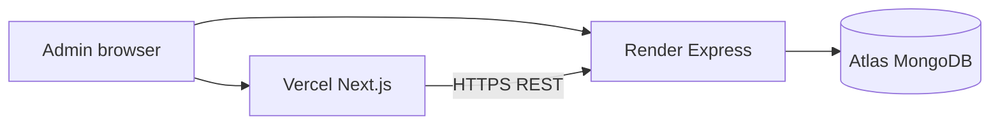

# Doctor Tracker — High-Level Design

Status: ready for implementation
Requirements: `docs/requirements-spec.md`
Detailed contracts: `docs/lld.md`

## 1. Design goal

Build a small system with senior boundaries. Two processes deploy independently. One API owns the rules. MongoDB stores the directory. The Next.js app is a client, not a second backend.

The design is a modular monolith behind a REST API, not a set of microservices. One team, one domain, and a two-day build do not pay for network hops between doctors and patients. The process split required by the brief is the client and the API.

## 2. System context

The admin never connects to the database. The portal never holds a MongoDB connection string.

## 3. Containers

| Container | Responsibility                                                     | Scales by                                                                                                     |
| --------- | ------------------------------------------------------------------ | ------------------------------------------------------------------------------------------------------------- |
| Web       | Routing, layout, forms, tables, charts, calling the API            | Extra static instances. No server session.                                                                    |
| API       | Identity, doctor directory, patient registry, dashboard read model | Extra stateless instances behind a load balancer.                                                             |
| MongoDB   | Durable documents and indexes                                      | A larger instance, then a replica set for availability. Not part of this build beyond a single Atlas cluster. |

Deployment targets match the submission rules: frontend on Vercel or Netlify, API on Render or an equivalent host, MongoDB on Atlas.

## 4. Component design

### 4.1 API modules

| Module             | Owns                                                      | Does not own            |
| ------------------ | --------------------------------------------------------- | ----------------------- |
| Identity           | Admins, password checks, access tokens, refresh sessions  | Clinical data           |
| Doctor directory   | Doctor records and directory search                       | Patient documents       |
| Patient registry   | Patient records, assignment to a doctor, soft delete      | How sessions are stored |
| Practice analytics | The dashboard read model                                  | Writes                  |
| HTTP               | Request ids, validation, auth guard, error shape, logging | Business decisions      |

`app.ts` mounts the routers. Controllers sit between those routers and the services. `app.ts` does not inject repositories. `patient.service` calls `doctor.model.findById` when it needs to know a doctor exists. It does not import `doctor.service`. `dashboard.service` calls count functions on the doctor and patient models. File layout is in `docs/lld.md` section 1.1.

### 4.2 Web modules

Pages may compose features. The doctor detail page composes the doctor summary and the patient table. Features do not import a sibling feature. Shared visual pieces (page header, data table, confirm dialog) are shadcn/ui components. They have no knowledge of doctors or patients.

## 5. Main flows

### 5.1 Sign-in and later requests

On a full page load the access token is gone, because it lives only in memory. The portal calls `POST /auth/refresh` with the cookie, receives a new access token, and then loads the page. A failed refresh sends the admin to login.

### 5.2 Add a patient under a doctor

The write is one document. Counts on the dashboard are computed when the dashboard is read, so this request does not update a counter on the doctor.

### 5.3 Dashboard read

`dashboard.service` runs indexed counts and grouped aggregations, then fills missing days with zeros. The browser draws the returned series. It does not receive patient documents.

## 6. API

Base path: `/api/v1`. Authentication is a bearer access token except where noted.

| Method | Path                          | Auth           | Purpose                                |
| ------ | ----------------------------- | -------------- | -------------------------------------- |
| GET    | `/health`                     | Public         | Process and database health            |
| POST   | `/auth/login`                 | Public         | Sign in                                |
| POST   | `/auth/refresh`               | Refresh cookie | Rotate session, issue access token     |
| POST   | `/auth/logout`                | Refresh cookie | Revoke session                         |
| GET    | `/auth/me`                    | Bearer         | Current admin                          |
| POST   | `/doctors`                    | Bearer         | Create a doctor                        |
| GET    | `/doctors`                    | Bearer         | Search, filter, and paginate doctors   |
| GET    | `/doctors/facets`             | Bearer         | Specialization and hospital values     |
| GET    | `/doctors/:doctorId`          | Bearer         | One doctor and active patient count    |
| PATCH  | `/doctors/:doctorId`          | Bearer         | Correct doctor fields                  |
| GET    | `/doctors/:doctorId/patients` | Bearer         | That doctor's patients                 |
| POST   | `/doctors/:doctorId/patients` | Bearer         | Add a patient under that doctor        |
| GET    | `/patients`                   | Bearer         | Search, filter, and paginate patients  |
| GET    | `/patients/:patientId`        | Bearer         | One active patient                     |
| PATCH  | `/patients/:patientId`        | Bearer         | Edit a patient, including reassignment |
| DELETE | `/patients/:patientId`        | Bearer         | Soft-delete a patient                  |
| GET    | `/dashboard`                  | Bearer         | Totals, breakdowns, and daily series   |

Success responses use `{ success, message, data }`. Lists add top-level `meta`. Errors use `{ success: false, message, data: null, error: { code, details } }`.

`GET /api/docs` serves Swagger UI for this table. `GET /api/docs/openapi.json` is the OpenAPI document. Both are public.

`GET /doctors/:doctorId/patients` is a constrained alias of the patient list. It checks that the doctor exists, then runs the same patient query with `doctorId` fixed. There is one list implementation.

## 7. Interfaces

Interfaces at this level are the boundaries between containers and between layers. Method signatures are in the LLD.

| Interface                | Producer                       | Consumer                                                    | Contract                                      |
| ------------------------ | ------------------------------ | ----------------------------------------------------------- | --------------------------------------------- |
| Portal HTTP API          | Express                        | Next.js                                                     | The REST table above                          |
| Access-token guard       | `require-admin` middleware     | Every private route                                         | Rejects missing, expired, or non-admin tokens |
| Doctor model             | `doctor.model`                 | `doctor.service`, `patient.service`, `dashboard.service`    | Existence check and directory reads           |
| Patient model            | `patient.model`                | `patient.service`, `dashboard.service`, doctor detail count | Registry reads and writes                     |
| Admin and session models | `admin.model`, `session.model` | `auth.service`                                              | Lookup, create, revoke                        |
| Password helper          | `lib/password.ts`              | Login and seed                                              | Hash and verify                               |
| Token helper             | `lib/tokens.ts`                | Login, refresh, guard                                       | Sign and verify                               |
| Portal API client        | `HttpDoctorTrackerApi`         | Feature hooks                                               | Typed methods matching the services           |

Hooks depend on the API client, which keeps a page test able to substitute a fake.

## 8. Dependencies

### 8.1 Allowed direction

| From         | May depend on                              | Must not depend on                                 |
| ------------ | ------------------------------------------ | -------------------------------------------------- |
| Models       | Mongoose                                   | Express, services, HTTP status codes               |
| Services     | Their models and `lib`                     | `req`, `res`, a sibling service                    |
| Routes       | The matching service and Zod schemas       | Mongoose models                                    |
| A feature UI | Its own hooks and shared visual components | A sibling feature, `fetch` scattered in components |
| Web app      | Features                                   | MongoDB                                            |

### 8.2 Technology choices

| Choice           | Decision                                                 | Why this one                                                                                                                                                                                                                                             |
| ---------------- | -------------------------------------------------------- | -------------------------------------------------------------------------------------------------------------------------------------------------------------------------------------------------------------------------------------------------------- |
| API framework    | Express on Node.js                                       | Required by the brief. It is a thin HTTP edge in this design.                                                                                                                                                                                            |
| Web framework    | Next.js App Router                                       | Required. Used as the UI shell and route structure. Data is loaded from the API, not from a Next.js database client.                                                                                                                                     |
| Database         | MongoDB                                                  | Required. Documents match the aggregate boundaries: a doctor document and a patient document.                                                                                                                                                            |
| ODM              | Mongoose, accessed only inside `models/`                 | Schema and index declarations live next to the collection. Services receive plain objects.                                                                                                                                                               |
| Validation       | Zod, on both edges                                       | One schema describes the accepted input and the TypeScript type.                                                                                                                                                                                         |
| API docs         | Swagger UI, generated from the Zod schemas               | `GET /api/docs` is the interactive reference. The OpenAPI document is produced from the same schemas the routes validate, so the docs cannot drift from the implementation.                                                                              |
| Password hashing | Argon2id                                                 | Resistant to GPU guessing for a low-entropy admin password.                                                                                                                                                                                              |
| Access token     | JWT, HMAC, 15 minutes                                    | Stateless across API instances.                                                                                                                                                                                                                          |
| Refresh session  | Random token, SHA-256 hash in MongoDB, `HttpOnly` cookie | Logout and rotation actually revoke access. A JWT refresh token would stay valid until expiry.                                                                                                                                                           |
| Server state     | TanStack Query                                           | Doctor and patient data is a cache of the API, with keys, invalidation, and request de-duplication.                                                                                                                                                      |
| Forms            | React Hook Form and Zod                                  | Field state stays local to the form, which protects the table from rerendering on each keystroke.                                                                                                                                                        |
| Charts           | Recharts                                                 | Draws the aggregated series in React. No chart vendor account.                                                                                                                                                                                           |
| UI               | Tailwind CSS and shadcn/ui                               | shadcn/ui supplies the accessible controls (button, input, dialog, select, table, dropdown). The components live in the repo and are styled with Tailwind, so the admin stays consistent without a custom design system or a packaged component runtime. |
| Dates            | Native Temporal API on API and web                       | Calendar bounds and dashboard buckets need a real timezone. No Luxon or other date dependency; `Temporal.PlainDate` / `ZonedDateTime` in shared calendar helpers. The client displays and validates `YYYY-MM-DD` with the same rules the API buckets.    |
| Logging          | pino                                                     | JSON logs with a request id.                                                                                                                                                                                                                             |

### 8.3 Decisions worth defending

**TanStack Query for server data.** A client store such as Redux would copy the API into reducers and still need a cache, invalidation, and in-flight requests. Redux fits shared client state. This portal's shared state is server state. The access token sits in a module variable, not in a store and not in `localStorage`.

**Aggregation instead of a patient counter on the doctor.** A counter makes the dashboard cheap and makes every patient write a two-document update. Those two writes need a transaction to stay correct, and a missed decrement stays wrong forever. At 10,000 patients an indexed `$group` is the simpler correct design. A counter becomes worthwhile when that aggregation stops meeting NFR-PERF-02.

**Bearer token plus a scoped refresh cookie.** The UI origin and the API origin are different. Data requests use the `Authorization` header, so a third-party page cannot submit them with a cookie. The refresh cookie is `HttpOnly`, so script cannot read it. Refresh and logout additionally check the calling origin.

**Soft delete without a restore screen.** A patient row is one document. Setting `deletedAt` is atomic. Active queries include `deletedAt: null` and are backed by partial indexes, so the extra field does not slow the active list.

## 9. Business logic structure

Policy lives in services. The shape is the same for every write:

1. The route validates shape and types.
2. The service loads what it needs from models.
3. The service applies the business rules from the requirements.
4. The service asks a model to persist the result.
5. The route maps the result or the domain error to a status code.

| Rule group                               | Where it is enforced                                                          |
| ---------------------------------------- | ----------------------------------------------------------------------------- |
| Credential check, session rotation, role | `auth.service` and the access-token guard                                     |
| Unique doctor email                      | `CreateDoctor` and `UpdateDoctor`, backed by a unique index                   |
| Patient must reference a real doctor     | `CreatePatient` and `UpdatePatient`                                           |
| Condition catalog                        | Zod, so bad input stops at the route                                          |
| Soft delete and "active" visibility      | `DeletePatient` sets `deletedAt`. Patient read queries add the active filter. |
| Page bounds and literal search           | List services, before the model is called                                     |
| Zero-filled calendar                     | `GetDashboard`, after the aggregation returns sparse days                     |

Models do not know these rules. A model that is told to insert a patient inserts it. The service has already proved the doctor exists.

## 10. Database schema

Four collections. No joins on the write path. The only lookup is the dashboard's attachment of a doctor's name to an aggregated doctor id, plus the patient service's existence check.

| Collection | Document                         | Notes                                                           |
| ---------- | -------------------------------- | --------------------------------------------------------------- |
| `admins`   | One seeded administrator         | Unique email. Password stored as an Argon2id hash.              |
| `sessions` | One refresh session              | Stores the hash of the token. A TTL index removes expired rows. |
| `doctors`  | One doctor                       | Email unique. Specialization and hospital kept as entered.      |
| `patients` | One patient and their assignment | `doctorId` references a doctor. `deletedAt` null means active.  |

Index strategy, in one sentence: index the fields that select and sort active lists, and do not index the free-text search.

| Query                                          | Index                                                                          |
| ---------------------------------------------- | ------------------------------------------------------------------------------ |
| Doctor email uniqueness                        | Unique index on `email`                                                        |
| Doctor list, newest first                      | `{ createdAt: -1, _id: -1 }`                                                   |
| Doctors by specialization and date             | `{ specialization: 1, createdAt: -1 }` with case-insensitive collation         |
| Doctors by hospital and date                   | `{ hospital: 1, createdAt: -1 }` with the same collation                       |
| A doctor's patients, newest registration first | Partial `{ doctorId: 1, registeredAt: -1, _id: -1 }` where `deletedAt` is null |
| Patients by registration date                  | Partial `{ registeredAt: -1, _id: -1 }` where `deletedAt` is null              |
| Patients by condition                          | Partial `{ condition: 1, registeredAt: -1 }` where `deletedAt` is null         |
| Refresh token lookup                           | Unique index on `tokenHash`                                                    |
| Session expiry                                 | TTL index on `expiresAt`                                                       |

Substring search is a bounded, escaped filter on the same paged query. It is not given a fake index. If the directory grows well past the design size, the replacement is an edge n-gram field or Atlas Search, not a larger page.

Field lists, partial-filter expressions, and the aggregation pipelines are in `docs/lld.md`.

## 11. Deployment and configuration

| Env                                           | Used by  | Purpose                         |
| --------------------------------------------- | -------- | ------------------------------- |
| `NEXT_PUBLIC_API_URL`                         | Web      | Public API origin               |
| `MONGODB_URI`                                 | API      | Atlas connection                |
| `JWT_ACCESS_SECRET`                           | API      | Access-token signing            |
| `FRONTEND_ORIGIN`                             | API      | CORS and cookie-origin check    |
| `APP_TIMEZONE`                                | API      | Calendar buckets. Default `UTC` |
| `ADMIN_NAME`, `ADMIN_EMAIL`, `ADMIN_PASSWORD` | API seed | Initial admin                   |

The API does not read request-specific state from memory. Render can replace the instance without migrating sessions. Atlas M0 is enough for the interview data size. Health checks hit `GET /health`.

Local development runs the web app and the API as two processes so the interview machine matches production's boundary.

## 12. Failure behavior

| Failure                          | Visible result                                                                                                         |
| -------------------------------- | ---------------------------------------------------------------------------------------------------------------------- |
| Bad input                        | 400 `VALIDATION_ERROR` with field messages                                                                             |
| Bad credentials                  | 401 `INVALID_CREDENTIALS`                                                                                              |
| Missing or expired access token  | 401 `UNAUTHENTICATED`. The client tries one refresh, then redirects to login.                                          |
| Valid token, wrong role          | 403 `FORBIDDEN`                                                                                                        |
| Unknown doctor or active patient | 404 with `DOCTOR_NOT_FOUND` or `PATIENT_NOT_FOUND`                                                                     |
| Duplicate doctor email           | 409 `EMAIL_IN_USE`                                                                                                     |
| Login rate exceeded              | 429 `RATE_LIMITED`                                                                                                     |
| Database unavailable             | 500 `INTERNAL` on data routes. Health returns `503` with `success: false` and `data.datetime` plus `database: "down"`. |
| API down while the page is open  | The query cache surfaces an error state and a retry. Cached pages stay on screen.                                      |

## 13. How the design meets the review

| Review focus       | Design response                                                                        |
| ------------------ | -------------------------------------------------------------------------------------- |
| Code structure     | Routes, services, and models. One file per feature in each layer                       |
| Query optimization | Partial indexes matched to list and dashboard pipelines, plus an explain-plan check    |
| UX                 | One shell, three destinations, server state kept out of form state                     |
| Data visualization | A single aggregated read model and charts that render points                           |
| Authentication     | Short-lived bearer token, revocable refresh session, role check                        |
| Next.js practice   | App Router for the shell. No database driver in the client.                            |
| MongoDB practice   | Document-per-aggregate, real indexes, aggregation for analytics                        |
| Scalability        | Stateless API, paged reads, an explicit next step when search outgrows the design size |

## 14. Follow-ons, deliberately not built

| Follow-on                                        | Trigger to build it                                                                                  |
| ------------------------------------------------ | ---------------------------------------------------------------------------------------------------- |
| Edge n-gram or Atlas Search                      | Substring search shows up as a collection scan in production profiles.                               |
| Denormalized `patientCount` and a transaction    | Dashboard aggregation exceeds the 300 ms budget.                                                     |
| Short-lived cache of `GET /dashboard`            | The same dashboard is requested often enough to matter. Cache only after the aggregation is correct. |
| Restore patient, delete doctor with reassignment | A product decision, not a technical gap.                                                             |
