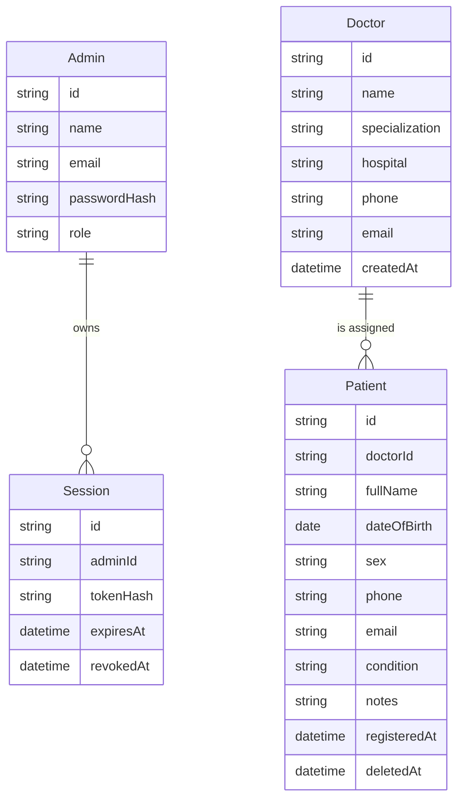

# Doctor Tracker — Requirements Specification

Status: ready for design and implementation
Scope: senior interview build of the Doctor Tracker admin portal
Sources: `docs/project_guide.md`

This document states what the system must do and the quality bar it must meet. Physical API schemas, TypeScript ports, and indexes are specified in `docs/lld.md`. System shape and decisions are in `docs/hld.md`.

## 1. Purpose

Doctor Tracker is a secure administrative web application. An authenticated admin manages a directory of doctors and the patients assigned to each doctor, and reads a dashboard that summarizes that directory.

The build is two separately deployed applications:

- a Next.js client
- a standalone Node.js and Express API
- MongoDB as the only database
- communication only over REST

## 2. Actors

| Actor          | Description                                                                          |
| -------------- | ------------------------------------------------------------------------------------ |
| Admin          | The only human user. Signs in and uses the portal.                                   |
| Browser client | The Next.js application acting on behalf of the admin.                               |
| API            | The Express application. Enforces authentication, authorization, and business rules. |
| Database       | MongoDB. Stores admins, sessions, doctors, and patients.                             |

There is no public patient user and no anonymous access to clinical data.

## 3. Assumptions

| Id  | Assumption                                                                                                                                                                                                |
| --- | --------------------------------------------------------------------------------------------------------------------------------------------------------------------------------------------------------- |
| A-1 | One role exists: `admin`. The first admin is seeded from environment configuration. There is no self-registration.                                                                                        |
| A-2 | A patient has exactly one doctor at a time.                                                                                                                                                               |
| A-3 | "Delete a patient from a doctor's list" and "delete a patient" are the same operation.                                                                                                                    |
| A-4 | The spec does not define a clinical date on a doctor. Date filters on doctors use the time the doctor record was created.                                                                                 |
| A-5 | Date filters on patients use `registeredAt`, the date the patient was registered with the doctor. It defaults to now and can be edited.                                                                   |
| A-6 | Patient condition is a closed catalog so it can be filtered and charted.                                                                                                                                  |
| A-7 | The demo data size to design for is up to 1,000 doctors and 10,000 patients. The structure stays correct above that size. Substring search is the first thing that would need a different index strategy. |
| A-8 | The UI is English only.                                                                                                                                                                                   |
| A-9 | Dates cross the API as ISO-8601. Calendar buckets use a single configured timezone, default `UTC`.                                                                                                        |

## 4. Functional requirements

Priority: **Must** is required by the project guide. **Should** is included because the admin workflow is incomplete without it. **Won't** is excluded on purpose.

### 4.1 Authentication and authorization

| Id         | Priority | Requirement                                                                                                                       |
| ---------- | -------- | --------------------------------------------------------------------------------------------------------------------------------- |
| FR-AUTH-01 | Must     | An admin can sign in with email and password.                                                                                     |
| FR-AUTH-02 | Must     | Every portal route and every data API route requires an authenticated admin.                                                      |
| FR-AUTH-03 | Must     | A signed-in admin can refresh the session without submitting the password again, until the refresh session expires or is revoked. |
| FR-AUTH-04 | Must     | An admin can log out. Logout revokes the current refresh session.                                                                 |
| FR-AUTH-05 | Must     | The client can read the current admin profile.                                                                                    |
| FR-AUTH-06 | Must     | Authorization rejects a valid token whose role is not `admin`.                                                                    |

### 4.2 Doctors

| Id        | Priority | Requirement                                                                                                                                                                           |
| --------- | -------- | ------------------------------------------------------------------------------------------------------------------------------------------------------------------------------------- |
| FR-DOC-01 | Must     | An admin can create a doctor with name, specialization, hospital, phone, and email.                                                                                                   |
| FR-DOC-02 | Must     | An admin can view a paginated list of doctors.                                                                                                                                        |
| FR-DOC-03 | Must     | An admin can search doctors.                                                                                                                                                          |
| FR-DOC-04 | Must     | An admin can filter doctors by creation date and by other directory attributes: specialization and hospital.                                                                          |
| FR-DOC-05 | Must     | Doctor results are paginated.                                                                                                                                                         |
| FR-DOC-06 | Must     | An admin can open a doctor and see that doctor's patients.                                                                                                                            |
| FR-DOC-07 | Should   | An admin can correct a doctor's name, specialization, hospital, phone, or email. The spec does not ask for this. It is included so a typo does not permanently corrupt the directory. |
| FR-DOC-08 | Should   | The client can load the distinct specialization and hospital values used by the filter controls.                                                                                      |

### 4.3 Patients

| Id        | Priority | Requirement                                                                                             |
| --------- | -------- | ------------------------------------------------------------------------------------------------------- |
| FR-PAT-01 | Must     | An admin can add a patient under a specific doctor.                                                     |
| FR-PAT-02 | Must     | A dedicated Patients page lists patients across doctors.                                                |
| FR-PAT-03 | Must     | An admin can edit patient information, including moving the patient to another doctor.                  |
| FR-PAT-04 | Must     | An admin can delete a patient. The patient disappears from lists, the doctor's list, and active counts. |
| FR-PAT-05 | Must     | Patient results are paginated.                                                                          |
| FR-PAT-06 | Must     | An admin can search patients.                                                                           |
| FR-PAT-07 | Must     | An admin can filter patients by registration date, condition, and doctor.                               |

### 4.4 Dashboard

| Id         | Priority | Requirement                                                                                                               |
| ---------- | -------- | ------------------------------------------------------------------------------------------------------------------------- |
| FR-DASH-01 | Must     | The dashboard shows the total number of doctors and the total number of active patients.                                  |
| FR-DASH-02 | Must     | The dashboard shows patients per doctor.                                                                                  |
| FR-DASH-03 | Must     | The dashboard shows date-based statistics for a selected range. The default range is the last 30 days.                    |
| FR-DASH-04 | Must     | Those figures are drawn as charts, not only as numbers.                                                                   |
| FR-DASH-05 | Should   | The dashboard shows the active patient count by condition. The condition filter makes this breakdown a meaningful visual. |

### 4.5 Interface behavior

| Id       | Priority | Requirement                                                                                                                                 |
| -------- | -------- | ------------------------------------------------------------------------------------------------------------------------------------------- |
| FR-UI-01 | Must     | The signed-in shell navigates clearly among Dashboard, Doctors, and Patients.                                                               |
| FR-UI-02 | Must     | Layouts work on a desktop width and a mobile width.                                                                                         |
| FR-UI-03 | Must     | Lists and the dashboard have distinct loading, empty, and error states.                                                                     |
| FR-UI-04 | Must     | Create and edit forms show field-level validation before the request, and they show server validation errors if the API rejects the submit. |
| FR-UI-05 | Must     | Destructive delete asks for confirmation.                                                                                                   |

## 5. Business rules

These rules are the business logic. They are enforced in the API use cases. The client may mirror validation for responsiveness. The client is not the authority.

| Id    | Rule                                                                                                                                                    |
| ----- | ------------------------------------------------------------------------------------------------------------------------------------------------------- |
| BR-01 | Login, refresh, logout, and the health check are the only API routes available without an admin access token.                                           |
| BR-02 | A failed login returns one message, "Invalid email or password", for an unknown email and for a wrong password.                                         |
| BR-03 | Doctor email is required and unique, compared case-insensitively.                                                                                       |
| BR-04 | Creating or updating a doctor with an email already used by another doctor is rejected.                                                                 |
| BR-05 | Doctor name, specialization, hospital, phone, and email are required.                                                                                   |
| BR-06 | A patient requires a full name, a condition, a registration date, and a doctor.                                                                         |
| BR-07 | The doctor referenced by a patient must already exist.                                                                                                  |
| BR-08 | Condition must be one of: `critical`, `serious`, `stable`, `recovering`, `chronic`, `observation`.                                                      |
| BR-09 | Delete is a soft delete. Active lists, counts, filters, and charts exclude deleted patients.                                                            |
| BR-10 | Deleting a missing patient, or a patient already deleted, returns not found.                                                                            |
| BR-11 | Deleting a patient does not delete or modify the doctor, other than the patient no longer appearing under that doctor.                                  |
| BR-12 | A patient is always assigned to one doctor. An edit may change that doctor.                                                                             |
| BR-13 | Doctors are not deleted in this version. A doctor with patients must not disappear out from under them.                                                 |
| BR-14 | Search text is trimmed, limited to 100 characters, and treated as a literal string. Regular-expression characters in the input have no special meaning. |
| BR-15 | Page numbers start at 1. Page size defaults to 20 and cannot exceed 50.                                                                                 |
| BR-16 | A page past the end returns an empty list and the true total. It is not an error.                                                                       |
| BR-17 | Default order is newest first: doctors by `createdAt`, patients by `registeredAt`, with `_id` as a stable tie-break.                                    |
| BR-18 | Date filters are inclusive. `from` must not be after `to`.                                                                                              |
| BR-19 | The dashboard date window defaults to the last 30 days inclusive and cannot exceed 366 days.                                                            |
| BR-20 | Totals and patients-per-doctor count active records for all time. The date window applies only to the date-based series.                                |
| BR-21 | Days inside the dashboard window with no records are returned as zero, so the chart does not invent the gaps.                                           |
| BR-22 | Passwords are never stored, logged, or returned.                                                                                                        |
| BR-23 | An invalid id format is a validation failure, not an internal error.                                                                                    |

### 5.1 Use-case structure

Each use case is the unit of business logic. HTTP handlers call use cases. Use cases do not know HTTP or MongoDB.

| Use case          | Fulfills                           | Outcome                                                                                |
| ----------------- | ---------------------------------- | -------------------------------------------------------------------------------------- |
| `Login`           | FR-AUTH-01                         | Issues an access token and a refresh session, or rejects the credentials.              |
| `RefreshSession`  | FR-AUTH-03                         | Rotates the refresh session and issues a new access token.                             |
| `Logout`          | FR-AUTH-04                         | Revokes the refresh session.                                                           |
| `GetCurrentAdmin` | FR-AUTH-05                         | Returns the admin named by a valid access token.                                       |
| `CreateDoctor`    | FR-DOC-01                          | Stores a doctor when the email is free and the fields are valid.                       |
| `ListDoctors`     | FR-DOC-02–05                       | Returns one page of doctors for the search, filters, and pagination given.             |
| `GetDoctor`       | FR-DOC-06                          | Returns one doctor and the active patient count.                                       |
| `UpdateDoctor`    | FR-DOC-07                          | Applies a partial correction.                                                          |
| `GetDoctorFacets` | FR-DOC-08                          | Returns distinct specialization and hospital values.                                   |
| `CreatePatient`   | FR-PAT-01                          | Stores a patient under an existing doctor.                                             |
| `ListPatients`    | FR-PAT-02, FR-PAT-05–07, FR-DOC-06 | Returns one page. A doctor id scopes the page to that doctor.                          |
| `GetPatient`      | FR-PAT-03                          | Returns one active patient.                                                            |
| `UpdatePatient`   | FR-PAT-03                          | Updates information and can move the patient to another existing doctor.               |
| `DeletePatient`   | FR-PAT-04                          | Soft-deletes an active patient.                                                        |
| `GetDashboard`    | FR-DASH-01–05                      | Returns totals, per-doctor counts, per-condition counts, and zero-filled daily series. |

## 6. External interface requirements

The system exposes one business interface: a versioned JSON REST API. The browser is a client of that API. There is no GraphQL, no server action that touches MongoDB, and no second write path.

| Interface         | Requirement                                                                                                                                          |
| ----------------- | ---------------------------------------------------------------------------------------------------------------------------------------------------- |
| REST API          | Base path `/api/v1`. JSON requests and responses. UTF-8.                                                                                             |
| Auth entry        | `POST /auth/login`, `POST /auth/refresh`, `POST /auth/logout`, `GET /auth/me`.                                                                       |
| Doctor entry      | Create, list, read, update, facet values.                                                                                                            |
| Patient entry     | Create under a doctor, list, list-by-doctor, read, update, delete.                                                                                   |
| Dashboard entry   | One read model for the whole dashboard.                                                                                                              |
| Health entry      | `GET /health` reports process and database reachability with `data.status`, `data.database`, and `data.datetime` (UTC). It exposes no clinical data. |
| Success interface | Every success JSON body includes `success: true`, `message`, and `data`. Deletes and logout may use `data: null`.                                    |
| Error interface   | Every error uses `success: false`, `message`, `data: null`, and `error.code` with optional `error.details`.                                          |
| List interface    | Every collection adds top-level `meta` with `page`, `limit`, `total`, and `totalPages`.                                                              |
| Time interface    | Timestamps are ISO-8601. Calendar inputs are `YYYY-MM-DD`.                                                                                           |
| API documentation | Swagger UI at `GET /api/docs`, backed by an OpenAPI document generated from the request schemas. Public. No clinical data.                           |

The endpoint-level contract is the API section of `docs/lld.md`.

## 7. Logical data model

This is the business data. Field limits, indexes, and storage types are in the LLD schema.

| Entity  | Identity  | Required information                            | Relationships         |
| ------- | --------- | ----------------------------------------------- | --------------------- |
| Admin   | system id | name, email, password hash, role                | owns refresh sessions |
| Session | system id | admin, hash of the refresh token, expiry        | belongs to one admin  |
| Doctor  | system id | name, specialization, hospital, phone, email    | has many patients     |
| Patient | system id | full name, condition, registration date, doctor | belongs to one doctor |

Patient date of birth, sex, phone, email, and notes are editable patient information. They are optional. Condition and doctor are not optional.

Deleted patients remain stored with `deletedAt` set so a delete cannot partially destroy a record and so a bad delete is recoverable by an operator. The UI does not offer restore in this version.

## 8. Dependencies

| Dependency               | Role                                                                                                            |
| ------------------------ | --------------------------------------------------------------------------------------------------------------- |
| Next.js client           | Renders the portal and calls the API. It does not connect to MongoDB.                                           |
| Express API              | Owns authentication, business rules, and persistence.                                                           |
| MongoDB                  | System of record for the four entities above.                                                                   |
| Admin seed configuration | Supplies the initial admin email and password.                                                                  |
| Browser                  | Runtime for the client. Must send cookies on authentication requests and store the access token only in memory. |

Runtime libraries are selected in `docs/hld.md` and bounded in `docs/lld.md`. Business modules depend on interfaces, not on those libraries, except at the composition root and the infrastructure layer.

## 9. Non-functional requirements

Targets match a single-instance deployment and the data size in A-7. They are measured on indexed queries, excluding the host's cold start.

### 9.1 Performance

| Id          | Requirement                                                                                                                                                                                                  |
| ----------- | ------------------------------------------------------------------------------------------------------------------------------------------------------------------------------------------------------------ |
| NFR-PERF-01 | Indexed list and detail reads return in under 200 ms at the 95th percentile for the design data size.                                                                                                        |
| NFR-PERF-02 | The dashboard returns in under 300 ms at the 95th percentile for the design data size.                                                                                                                       |
| NFR-PERF-03 | Every list and dashboard query that filters by equality or date uses an index. An integration check asserts an index scan for doctor-scoped patient lists, condition filters, and registration-date filters. |
| NFR-PERF-04 | List endpoints never load an unbounded result. The repository applies the page size.                                                                                                                         |
| NFR-PERF-05 | The dashboard aggregates in MongoDB. The client receives points, not raw patients, and does not reduce clinical rows in the browser.                                                                         |
| NFR-PERF-06 | The client does not rerender the full table when the admin types in an unrelated control. Server state lives in the query cache. Form state stays inside the form.                                           |

### 9.2 Security

| Id         | Requirement                                                                                                                           |
| ---------- | ------------------------------------------------------------------------------------------------------------------------------------- |
| NFR-SEC-01 | Passwords are hashed with Argon2id before they are written.                                                                           |
| NFR-SEC-02 | The access token is a signed JWT with a 15-minute lifetime. It is sent as a bearer token and kept in memory.                          |
| NFR-SEC-03 | The refresh token is a random secret stored only as a SHA-256 hash. The browser copy is an `HttpOnly` cookie scoped to the auth path. |
| NFR-SEC-04 | Refresh rotates the session. A reused revoked refresh token is rejected.                                                              |
| NFR-SEC-05 | Login is rate limited.                                                                                                                |
| NFR-SEC-06 | The API validates every path parameter, query parameter, and body on the server.                                                      |
| NFR-SEC-07 | The API allows browser calls only from the configured frontend origin, and only with credentials where cookies are required.          |
| NFR-SEC-08 | Cookie-authenticated requests (refresh and logout) are accepted only from the configured origin.                                      |
| NFR-SEC-09 | Responses, logs, and errors never contain password hashes, refresh tokens, or access tokens.                                          |
| NFR-SEC-10 | Security headers are set. JSON bodies larger than 16 KB are rejected. This system accepts no file uploads.                            |

### 9.3 Reliability and correctness

| Id         | Requirement                                                                                                      |
| ---------- | ---------------------------------------------------------------------------------------------------------------- |
| NFR-REL-01 | Unexpected exceptions become a generic internal error with a request id. The stack is logged on the server only. |
| NFR-REL-02 | Writes are single-document. The design does not need a multi-document transaction.                               |
| NFR-REL-03 | `GET /health` fails when the process cannot reach MongoDB, so the host can restart it.                           |
| NFR-REL-04 | The API process stores no session state in memory. Any instance can serve any request.                           |

### 9.4 Maintainability

| Id           | Requirement                                                                                                           |
| ------------ | --------------------------------------------------------------------------------------------------------------------- |
| NFR-MAINT-01 | Business rules live in use cases. Route handlers do not query the database. Repositories do not decide authorization. |
| NFR-MAINT-02 | Domain types do not import Express, Mongoose, or React.                                                               |
| NFR-MAINT-03 | Each backend module has one reason to change: auth, doctors, patients, or dashboard.                                  |
| NFR-MAINT-04 | Frontend features do not import each other. Pages compose features.                                                   |
| NFR-MAINT-05 | Request and response types are defined once per boundary and validated with a schema.                                 |

### 9.5 Usability and presentation

| Id        | Requirement                                                                                                              |
| --------- | ------------------------------------------------------------------------------------------------------------------------ |
| NFR-UX-01 | The UI is a modern admin layout: consistent spacing, a clear type hierarchy, and an obvious primary action on each page. |
| NFR-UX-02 | Interactive controls have visible labels, keyboard access, and focus states.                                             |
| NFR-UX-03 | Tables remain usable at a narrow width by stacking or by a horizontal scroll region that does not clip the page.         |
| NFR-UX-04 | Charts have a title, a legend or direct labels, and an empty state when the series is all zeros.                         |

### 9.6 Scalability

| Id           | Requirement                                                                                                                                                                                                        |
| ------------ | ------------------------------------------------------------------------------------------------------------------------------------------------------------------------------------------------------------------ |
| NFR-SCALE-01 | Adding an API instance requires no session affinity.                                                                                                                                                               |
| NFR-SCALE-02 | Growth past the design size is addressed first by the indexes already specified, then by replacing substring search. Caching and a denormalized patient counter are documented follow-ons, not part of this build. |

### 9.7 Operability

| Id         | Requirement                                                                                                                              |
| ---------- | ---------------------------------------------------------------------------------------------------------------------------------------- |
| NFR-OPS-01 | Both applications start from environment variables. An `.env.example` ships with each repository. Secrets have no default in production. |
| NFR-OPS-02 | Logs are structured JSON and include the request id.                                                                                     |
| NFR-OPS-03 | A seed command creates the admin if that email is not already present.                                                                   |

## 10. Out of scope

| Item                                                               | Reason                                                                     |
| ------------------------------------------------------------------ | -------------------------------------------------------------------------- |
| Deleting a doctor                                                  | Patients must keep a valid doctor. No reassignment workflow was specified. |
| Restore-patient UI                                                 | Soft delete protects the data. A restore screen was not requested.         |
| Self-registration, password reset, and multi-factor authentication | One seeded admin is the interview scope.                                   |
| More than one role                                                 | The authorization check exists. Extra roles do not.                        |
| Audit-log screen, notifications, attachments                       | Not in the project guide.                                                  |
| FHIR, ICD coding, appointments, billing                            | This is a directory and a dashboard, not a clinical record system.         |
| Offline mode and service workers                                   | Not required to demonstrate the portal.                                    |
| Sharing a published package between the two repositories           | The REST contract is the shared surface. Types are mirrored on each side.  |

## 11. Acceptance criteria

| Criteria                                                                                                                           | Covers                               |
| ---------------------------------------------------------------------------------------------------------------------------------- | ------------------------------------ |
| An anonymous visitor who opens Dashboard, Doctors, or Patients is sent to login.                                                   | FR-AUTH-02                           |
| Wrong password and unknown email produce the same error and no token.                                                              | FR-AUTH-01, BR-02                    |
| After login, refreshing the browser restores the session through the refresh cookie.                                               | FR-AUTH-03                           |
| Logout prevents the old refresh cookie from issuing a new access token.                                                            | FR-AUTH-04                           |
| A second doctor with the same email is rejected.                                                                                   | BR-03, BR-04                         |
| Doctor list search finds a doctor by a fragment of name, and specialization and hospital filters combine with a date range.        | FR-DOC-03, FR-DOC-04                 |
| Page size never exceeds 50, and page 2 does not repeat page 1.                                                                     | BR-15, BR-17                         |
| A doctor's page lists only that doctor's active patients.                                                                          | FR-DOC-06, BR-09                     |
| Creating a patient with an unknown doctor fails and writes nothing.                                                                | BR-07                                |
| Editing a patient can change condition and move the patient to another doctor. The previous doctor's list no longer contains them. | FR-PAT-03, BR-12                     |
| Delete removes the patient from the global list, the doctor list, the total, and the per-doctor chart.                             | FR-PAT-04, BR-09                     |
| Condition and registration-date filters change the patient list.                                                                   | FR-PAT-07                            |
| Dashboard totals match active records. A day with no registrations appears as zero.                                                | FR-DASH-01, FR-DASH-03, BR-20, BR-21 |
| Explain plans for the indexed list shapes use an index scan.                                                                       | NFR-PERF-03                          |
| Mobile and desktop screenshots show Dashboard, Doctors, and Patients.                                                              | FR-UI-02, README visual evidence     |

## 12. Traceability

| Area           | Requirements                   | Design home                             |
| -------------- | ------------------------------ | --------------------------------------- |
| API            | Section 6                      | HLD API overview, LLD API               |
| Interfaces     | Section 6 and use cases in 5.1 | LLD interfaces                          |
| Dependencies   | Section 8                      | HLD and LLD dependencies                |
| Business logic | Section 5                      | LLD business logic structure            |
| Database       | Section 7                      | HLD logical schema, LLD physical schema |
